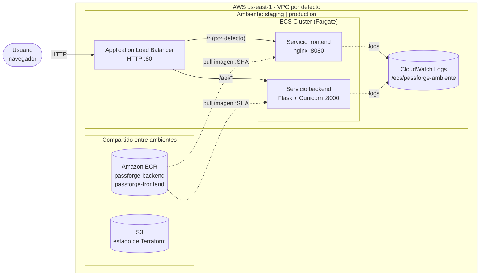
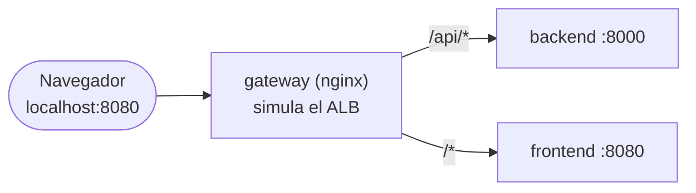

# PassForge

Generador de contraseñas aleatorias seguras con comprobador de fortaleza.

Proyecto del curso **Integración y Entrega Continua de Software**. La app es
deliberadamente sencilla: el objetivo del curso es construir a su alrededor
pruebas unitarias, cobertura, pruebas de aceptación y, más adelante, todo el
ciclo DevOps (Docker, CI/CD).

## Arquitectura

No es un monolito: frontend y backend son aplicaciones independientes que se
comunican por una API REST en JSON, cada una en su propio contenedor.

| Componente | Tecnología | Imagen base | Puerto |
|---|---|---|---|
| **Frontend** | HTML + CSS + JavaScript (sin frameworks) | `nginx-unprivileged:1.27-alpine` | 8080 |
| **Backend** | Python 3.13 + Flask + Gunicorn | `python:3.13-slim` | 8000 |

El backend no tiene base de datos ni guarda contraseñas: es *stateless*, así que
sus contenedores se pueden reemplazar o escalar sin perder información.

### Arquitectura en AWS (por ambiente)

Cada ambiente (**staging** y **production**) tiene su propia copia completa de la
infraestructura, creada con el mismo código Terraform. Los repositorios de
imágenes (ECR) son **compartidos**: la misma imagen probada en staging es la que
llega a producción.



**Flujo de una petición:**

1. El usuario abre `http://<alb>/` y el ALB envía la petición al **frontend** (regla por defecto).
2. El navegador carga la página y llama a `/api/v1/...` **en el mismo dominio**.
3. El ALB detecta el prefijo `/api/*` y la envía al **backend** (listener rule, prioridad 10).
4. El backend responde en JSON y el frontend muestra el resultado.

Como ambos componentes se sirven desde el mismo origen, no hay problemas de CORS
ni hay que configurar la URL del backend en el frontend (`frontend/js/config.js`
usa la ruta relativa `/api/v1`; solo en desarrollo local, puerto 5500, apunta a `:8000`).

### Infraestructura como código (Terraform)

El código está en [`infra/`](infra/), dividido en dos *root modules*:

| Carpeta | Se aplica | Recursos |
|---|---|---|
| `infra/ecr/` | Una sola vez | 2 repositorios ECR: tags inmutables, escaneo de vulnerabilidades al subir, retención de las últimas 10 imágenes |
| `infra/app/` | Una vez por ambiente (workspaces `staging` y `production`) | ALB, listener + regla `/api/*`, 2 target groups, 2 security groups, cluster ECS, 2 task definitions, 2 servicios Fargate, log group |

| Recurso (ej. staging) | Detalle |
|---|---|
| `passforge-staging-alb` | ALB público, puerto 80 |
| `passforge-staging-be-tg` | Target group del backend; health check `GET /api/v1/health` |
| `passforge-staging-fe-tg` | Target group del frontend; health check `GET /` |
| `passforge-staging-cluster` | Cluster ECS (Fargate) |
| `passforge-staging-backend` | Servicio backend: 1 tarea, 0.25 vCPU / 512 MB |
| `passforge-staging-frontend` | Servicio frontend: 1 tarea, 0.25 vCPU / 512 MB |
| `/ecs/passforge-staging` | Logs en CloudWatch (7 días), prefijos `backend/` y `frontend/` |

El estado de Terraform se guarda en un bucket **S3 con bloqueo** (`use_lockfile`),
para que el pipeline y los desarrolladores compartan el mismo estado sin pisarse.

### Decisiones de diseño

| Decisión | Por qué |
|---|---|
| **ECS Fargate** (sin EC2) | No hay servidores que administrar; se paga solo por los contenedores en ejecución. |
| **Un ALB con path routing** en lugar de dos ALB | Un solo punto de entrada y un solo dominio por ambiente: sin CORS y menor costo. |
| **ECR compartido + tag = SHA del commit** | La imagen se construye una vez y se despliega idéntica en ambos ambientes (*build once, deploy many*). Cada versión desplegada corresponde a un commit. |
| **Tags inmutables** en ECR | Un tag nunca se sobrescribe, lo que permite hacer rollback a una imagen exacta. |
| **Workspaces de Terraform** | El mismo código crea staging y producción; solo cambia la variable del ambiente, así que quedan iguales. |
| **Deployment circuit breaker** con rollback | Si una versión nueva no pasa los health checks, ECS vuelve sola a la anterior. |
| **Despliegue rolling (100 % / 200 %)** | La versión nueva arranca antes de apagar la anterior: despliegues sin caída. |

### Seguridad de la infraestructura

- Los contenedores **solo aceptan tráfico desde el ALB** (security group); no son accesibles directamente desde Internet.
- Los contenedores corren con **usuarios sin privilegios** (no root).
- El backend corre en modo `production`: sin debug, CORS restringido al dominio del ALB y `TRUST_PROXY` activo para que el rate limit use la IP real del cliente.
- **Escaneo de vulnerabilidades** de las imágenes al subirlas a ECR.
- Las imágenes no incluyen `.env`, pruebas ni archivos de desarrollo (`.dockerignore`).
- Las credenciales de AWS viven solo en GitHub Secrets, nunca en el código.

## API (resumen)

| Método | Ruta                          | Descripción                          |
|--------|-------------------------------|--------------------------------------|
| GET    | `/api/v1/health`              | Estado del servicio                  |
| GET    | `/api/v1/passwords/options`   | Política y opciones admitidas        |
| POST   | `/api/v1/passwords/generate`  | Genera una contraseña aleatoria      |
| POST   | `/api/v1/passwords/strength`  | Evalúa la fortaleza de una contraseña|

Detalle completo en [`backend/README.md`](backend/README.md).

## Ejecutar en local

Terminal 1 — backend:

```bash
cd backend
python3.13 -m venv .venv          # Python 3.10+ (en macOS no uses el python3 del sistema)
source .venv/bin/activate
pip install -r requirements.txt
cp .env.example .env
python wsgi.py
```

Terminal 2 — frontend:

```bash
cd frontend
python3 -m http.server 5500 --bind 127.0.0.1
```

Abre <http://127.0.0.1:5500>.

### Con Docker (igual que en AWS)

`docker-compose.yml` reproduce la arquitectura de AWS en local: un contenedor
`gateway` (nginx) cumple el papel del ALB y enruta `/api/*` al backend y el resto
al frontend.



```bash
docker compose up --build   # abre http://localhost:8080
docker compose down
```

## Pruebas

```bash
cd backend
pip install -r requirements-dev.txt
pytest --cov --cov-report=term-missing
```

Pruebas unitarias, modulares y de integración; detalle en
[`backend/README.md`](backend/README.md#pruebas).

## Estructura

```
passforge/
├── backend/              # API REST en Flask (+ Dockerfile)
├── frontend/             # interfaz web estática (+ Dockerfile y nginx.conf)
├── gateway/              # nginx que simula el ALB en docker-compose
├── infra/
│   ├── ecr/              # Terraform: repositorios de imágenes (compartidos)
│   └── app/              # Terraform: ALB + ECS por ambiente (workspaces)
├── docker-compose.yml
├── .editorconfig
├── .gitignore
└── README.md
```
=======
# proyecto_passforge
Proyecto de Integración continua de software. En este proyecto se desarrolla la aplicación PassForge, generador de contraseñas.
