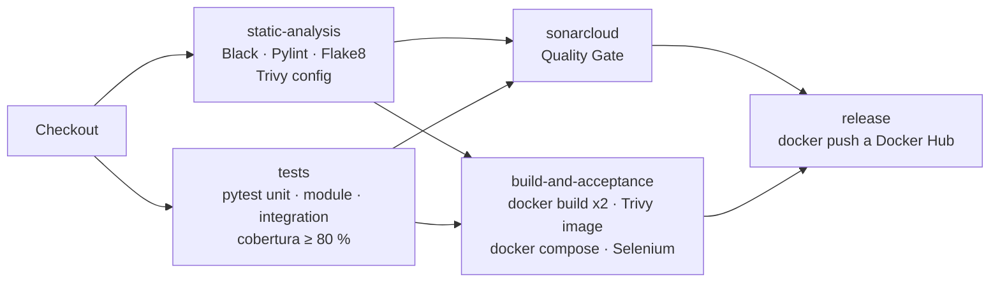

# PassForge

[](https://github.com/SantiagoAlvP/proyecto_passforge/actions/workflows/ci.yml)

Generador de contraseñas aleatorias seguras con comprobador de fortaleza.

Proyecto final del curso **Integración y Entrega Continua de Software**
(EAFIT): una aplicación de dos componentes (frontend y backend) con un pipeline
completo de CI/CD.

## Integrantes

| Nombre completo | Usuario de GitHub | Rol |
|---|---|---|
| _(completar)_ | [@SantiagoAlvP](https://github.com/SantiagoAlvP) | Propietario del repositorio |
| _(completar)_ | _(completar)_ | Colaborador |
| _(completar)_ | _(completar)_ | Colaborador |

## Arquitectura

No es un monolito: frontend y backend son aplicaciones independientes, cada
una en su propio contenedor Docker, que se comunican por una API REST en JSON.

```
                    Navegador
        ┌───────────────┴───────────────┐
        │ HTML/CSS/JS          API JSON │
        ▼                               ▼
┌─────────────────────┐     ┌──────────────────────────┐
│ frontend            │     │ backend                  │
│ nginx, puerto 8080  │     │ Gunicorn, puerto 8000    │
└─────────────────────┘     └──────────────────────────┘
```

| Componente | Tecnología | Imagen Docker |
|---|---|---|
| Frontend | HTML + CSS + JavaScript, servido con nginx (sin root) | `passforge-frontend` |
| Backend | Python 3.13 + Flask, servido con Gunicorn (sin root) | `passforge-backend` |

La URL del API que usa el frontend se configura al **ejecutar** el contenedor
(variable `API_BASE_URL`), no al construirlo: la misma imagen sirve en todos
los ambientes.

### API

| Método | Ruta | Descripción |
|---|---|---|
| GET | `/api/v1/health` | Estado del servicio |
| GET | `/api/v1/passwords/options` | Política y opciones admitidas |
| POST | `/api/v1/passwords/generate` | Genera una contraseña aleatoria |
| POST | `/api/v1/passwords/strength` | Evalúa la fortaleza de una contraseña |

Detalle en [`backend/README.md`](backend/README.md).

## Ejecutar

### Con Docker (recomendado)

```bash
docker compose up --build
```

Abre <http://localhost:8080>. Para detener: `Ctrl + C` y `docker compose down`.

### Sin Docker (desarrollo)

```bash
# Terminal 1: backend
cd backend
python3.13 -m venv .venv && source .venv/bin/activate
pip install -r requirements-dev.txt
cp .env.example .env
python wsgi.py

# Terminal 2: frontend
cd frontend
python3 -m http.server 5500 --bind 127.0.0.1
```

Abre <http://127.0.0.1:5500>.

## Pruebas

| Nivel | Dónde | Qué valida | Comando |
|---|---|---|---|
| Estáticas | `backend/` | Formato (Black), calidad (Pylint, Flake8), Dockerfiles (Trivy) | `black --check backend` · `pylint backend/app` · `flake8 backend/app` |
| Unitarias | `backend/tests/unit/` | Cada función o clase, aislada | `pytest -m unit` |
| Modulares | `backend/tests/module/` | Cada módulo completo, independiente del resto | `pytest -m module` |
| Integración | `backend/tests/integration/` | La API completa con todas sus capas | `pytest -m integration` |
| Aceptación | `acceptance/` | Flujos de usuario en un navegador real (Selenium) contra los contenedores | `pytest acceptance` |

Cobertura (mínimo 80 %, actual 100 % de líneas y ramas):

```bash
cd backend
pytest --cov --cov-report=term-missing --cov-fail-under=80
```

Pruebas de aceptación (con la app corriendo en Docker):

```bash
docker compose up --build -d
pip install -r acceptance/requirements.txt
pytest acceptance
docker compose down
```

## Pipeline de CI

Archivo: [`.github/workflows/ci.yml`](.github/workflows/ci.yml) (GitHub Actions).



| Job | Etapa | Qué hace | Herramientas |
|---|---|---|---|
| `static-analysis` | Test (estáticas) | Verifica formato, genera reportes de linters, revisa los Dockerfiles y reporta la seguridad de la infraestructura (Terraform) | Black, Pylint, Flake8, Trivy |
| `tests` | Test (unitarias y cobertura) | 246 pruebas unitarias, modulares y de integración; falla si la cobertura es < 80 % | pytest, pytest-cov, pytest-html |
| `sonarcloud` | Test (estáticas) | Análisis continuo de calidad y seguridad de los dos componentes; falla si el Quality Gate no pasa | SonarCloud |
| `build-and-acceptance` | Build + Test | Construye las dos imágenes, busca vulnerabilidades, levanta la app y ejecuta las pruebas de aceptación sobre los contenedores | Docker, Docker Compose, Trivy, Selenium |
| `release` | Release | Publica en Docker Hub **las mismas imágenes probadas** (sin reconstruirlas) y las entrega al CD como salidas del job | Docker Hub |

### Ramas y eventos

Estrategia **trunk-based con Pull Requests**: `main` siempre está estable y
protegida; cada cambio se hace en una rama corta (`feature/...`, `fix/...`,
`docs/...`) y entra a `main` por un Pull Request aprobado y con el pipeline en
verde.

| Evento | Qué se ejecuta | ¿Publica imágenes? |
|---|---|---|
| Pull Request hacia `main` | Todo menos `release` | No |
| Push a `main` (merge de un PR) | Todo | Sí: etiquetas `<sha>` y `latest` |
| Tag `vX.Y.Z` | Todo | Sí: etiquetas `<sha>` y `X.Y.Z` |
| Manual (`workflow_dispatch`) | Todo menos `release` | No |

### Política de fallos

| Paso | ¿Detiene el pipeline? |
|---|---|
| Black | Sí, si hay código sin formatear |
| Pylint y Flake8 | No por hallazgos (`--exit-zero`); SonarCloud decide con el Quality Gate |
| Trivy (Dockerfiles) | Sí, con hallazgos HIGH o CRITICAL |
| Trivy (Terraform en `infra/`) | No: solo reporta. El Learner Lab obliga a un ALB público por HTTP y security groups abiertos, que Trivy marca como HIGH/CRITICAL |
| Pruebas y cobertura | Sí, si una prueba falla o la cobertura es < 80 % |
| Trivy (imágenes) | Sí, con vulnerabilidades CRITICAL que tienen solución |
| Pruebas de aceptación | Sí, si la app empaquetada no se comporta como espera el usuario |
| SonarCloud | Sí, si el Quality Gate no es `Passed` |
| Release | Solo en push a `main` o tag, y solo si todo lo anterior pasó |

Los reportes (pruebas, cobertura, linters, aceptación y seguridad) quedan en
**Artifacts** de cada ejecución.

### Contrato con el CD

Lo que el pipeline de CI entrega para desplegar:

| | Backend | Frontend |
|---|---|---|
| Imagen | `<DOCKERHUB_USERNAME>/passforge-backend:<sha>` | `<DOCKERHUB_USERNAME>/passforge-frontend:<sha>` |
| Salida del job `release` | `needs.release.outputs.backend_image` | `needs.release.outputs.frontend_image` |
| Puerto | 8000 | 8080 |
| Health check | `/api/v1/health` → `{"status": "ok", "version": "<APP_VERSION>"}` | `/health` → `{"status": "ok"}` |
| Variables de entorno | `CORS_ORIGINS` (obligatoria: URL pública), `TRUST_PROXY=true` (detrás del ALB), `APP_VERSION=<sha>` | `API_BASE_URL` (por defecto `/api/v1`, mismo origen) |

La etiqueta (SHA del commit) también está en `needs.release.outputs.image_tag`.
Para confirmar que un ambiente ya corre la versión nueva, se espera a que
`/api/v1/health` responda con `"version": "<sha>"`.

### Configuración necesaria en GitHub

**Settings → Secrets and variables → Actions**

| Tipo | Nombre | Valor |
|---|---|---|
| Secret | `SONAR_TOKEN` | Token de SonarCloud |
| Secret | `DOCKERHUB_TOKEN` | Personal Access Token de Docker Hub (Read & Write) |
| Variable | `DOCKERHUB_USERNAME` | Usuario (Docker ID) de Docker Hub |
| Variable | `SONAR_HOST_URL` | `https://sonarcloud.io` |

**SonarCloud:** importar el repositorio, desactivar *Automatic Analysis*,
*New code* = 30 días, proyecto público, y verificar que `sonar.projectKey` y
`sonar.organization` de [`sonar-project.properties`](sonar-project.properties)
coincidan con los del proyecto.

**Protección de `main`** (Settings → Rules → Rulesets): PR obligatorio con 1
aprobación y checks requeridos `static-analysis`, `tests`, `sonarcloud` y
`build-and-acceptance`.

### Cambios respecto al pipeline del taller

1. **Dos componentes**: se construyen, escanean, prueban y publican dos
   imágenes (frontend y backend), orquestadas con Docker Compose.
2. **Pipeline en jobs paralelos** con dependencias (`needs`): las pruebas
   estáticas y las unitarias corren en paralelo; la imagen probada pasa al job
   de release como artefacto, sin reconstruirse.
3. **Seguridad en el pipeline (DevSecOps)** con Trivy: revisión de los
   Dockerfiles y escaneo de vulnerabilidades de las imágenes antes de
   publicarlas.
4. **Versionamiento con tags**: un tag `vX.Y.Z` publica las imágenes con esa
   versión.
5. **Tres niveles de pruebas automatizadas** del backend (unitarias,
   modulares y de integración) además de las de aceptación.

## Estructura

```
passforge/
├── .github/workflows/ci.yml   # pipeline de CI
├── backend/                   # API REST (Flask) + Dockerfile + pruebas
├── frontend/                  # interfaz web (nginx) + Dockerfile
├── acceptance/                # pruebas de aceptación (Selenium)
├── docker-compose.yml         # la app completa con Docker
├── sonar-project.properties   # configuración de SonarCloud
├── .flake8
└── README.md
```
