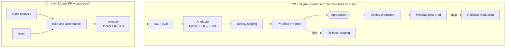

# PassForge

[](https://github.com/SantiagoAlvP/proyecto_passforge/actions/workflows/ci.yml)
[](https://github.com/SantiagoAlvP/proyecto_passforge/actions/workflows/cd.yml)

Generador de contraseñas aleatorias seguras con comprobador de fortaleza.

Proyecto final del curso **Integración y Entrega Continua de Software**
(EAFIT): una aplicación de dos componentes (frontend y backend) con un pipeline
completo de CI/CD desplegado en AWS.

## Integrantes

| Nombre completo | Usuario de GitHub | Rol |
|---|---|---|
| _(completar)_ | [@SantiagoAlvP](https://github.com/SantiagoAlvP) | Propietario del repositorio |
| _(completar)_ | [@tomechava](https://github.com/tomechava) | Colaborador |
| _(completar)_ | [@imKorr](https://github.com/imKorr) | Colaborador |

## Arquitectura

No es un monolito: frontend y backend son aplicaciones independientes, cada
una en su propio contenedor Docker, que se comunican por una API REST en JSON.

| Componente | Tecnología | Imagen base | Puerto |
|---|---|---|---|
| **Frontend** | HTML + CSS + JavaScript (sin frameworks), servido con nginx sin root | `nginx/nginx-unprivileged:1.30-alpine` | 8080 |
| **Backend** | Python 3.13 + Flask, servido con Gunicorn sin root | `python:3.13-slim` | 8000 |

El backend no tiene base de datos ni guarda contraseñas: es *stateless*, así que
sus contenedores se pueden reemplazar o escalar sin perder información.

La URL del API que usa el frontend se configura al **ejecutar** el contenedor
(variable `API_BASE_URL`, por defecto `/api/v1`), no al construirlo: la misma
imagen sirve en todos los ambientes.

### Arquitectura en AWS (por ambiente)

Cada ambiente (**staging** y **production**) tiene su propia copia completa de la
infraestructura, creada con el mismo código Terraform. Los repositorios de
imágenes (ECR) son **compartidos**: la misma imagen probada en staging es la que
llega a producción.


**Flujo de una petición:**

1. El usuario abre `http://<alb>/` y el ALB envía la petición al **frontend** (regla por defecto).
2. El navegador carga la página y llama a `/api/v1/...` **en el mismo dominio**.
3. El ALB detecta el prefijo `/api/*` y la envía al **backend** (listener rule, prioridad 10).
4. El backend responde en JSON y el frontend muestra el resultado.

Como ambos componentes se sirven desde el mismo origen, no hay problemas de
CORS: el contenedor del frontend usa la ruta relativa `/api/v1` (valor por
defecto de `API_BASE_URL`).

### Infraestructura como código (Terraform)

El código está en [`infra/`](infra/), dividido en dos *root modules*:

| Carpeta | Se aplica | Recursos |
|---|---|---|
| `infra/ecr/` | Una sola vez | 2 repositorios ECR: tags inmutables, escaneo de vulnerabilidades al subir, retención de las últimas 10 imágenes |
| `infra/app/` | Una vez por ambiente (workspaces `staging` y `production`) | ALB, listener + regla `/api/*`, 2 target groups, 2 security groups, cluster ECS, 2 task definitions, 2 servicios Fargate, log group |

| Recurso (ej. staging) | Detalle |
|---|---|
| `passforge-staging-alb` | ALB público, puerto 80 |
| `passforge-staging-be-tg` | Target group del backend; health check `GET /api/v1/health` |
| `passforge-staging-fe-tg` | Target group del frontend; health check `GET /health` |
| `passforge-staging-cluster` | Cluster ECS (Fargate) |
| `passforge-staging-backend` | Servicio backend: 1 tarea, 0.25 vCPU / 512 MB |
| `passforge-staging-frontend` | Servicio frontend: 1 tarea, 0.25 vCPU / 512 MB |
| `/ecs/passforge-staging` | Logs en CloudWatch (7 días), prefijos `backend/` y `frontend/` |

El estado de Terraform se guarda en un bucket **S3 con bloqueo** (`use_lockfile`),
para que el pipeline y los desarrolladores compartan el mismo estado sin pisarse.

### Decisiones de diseño

| Decisión | Por qué |
|---|---|
| **ECS Fargate** (sin EC2) | No hay servidores que administrar; se paga solo por los contenedores en ejecución. |
| **Un ALB con path routing** en lugar de dos ALB | Un solo punto de entrada y un solo dominio por ambiente: sin CORS y menor costo. |
| **Build once, deploy many** | El CI construye y prueba la imagen una vez (tag = SHA del commit); el CD la promueve de Docker Hub a ECR y despliega esa misma imagen en ambos ambientes. |
| **Tags inmutables** en ECR | Un tag nunca se sobrescribe, lo que permite hacer rollback a una imagen exacta. |
| **Workspaces de Terraform** | El mismo código crea staging y producción; solo cambia la variable del ambiente, así que quedan iguales. |
| **Deployment circuit breaker** con rollback | Si una versión nueva no pasa los health checks, ECS vuelve sola a la anterior. |
| **Despliegue rolling (100 % / 200 %)** | La versión nueva arranca antes de apagar la anterior: despliegues sin caída. |

### Seguridad de la infraestructura

- Los contenedores **solo aceptan tráfico desde el ALB** (security group); no son accesibles directamente desde Internet.
- Los contenedores corren con **usuarios sin privilegios** (no root).
- El backend corre en modo `production`: sin debug, CORS restringido al dominio del ALB y `TRUST_PROXY` activo para que el rate limit use la IP real del cliente.
- **Escaneo de vulnerabilidades** de las imágenes con Trivy en el CI y al subirlas a ECR.
- Las imágenes no incluyen `.env`, pruebas ni archivos de desarrollo (`.dockerignore`).
- Las credenciales de AWS viven solo en GitHub Secrets, nunca en el código.

### API

| Método | Ruta | Descripción |
|---|---|---|
| GET | `/api/v1/health` | Estado del servicio y versión desplegada |
| GET | `/api/v1/passwords/options` | Política y opciones admitidas |
| POST | `/api/v1/passwords/generate` | Genera una contraseña aleatoria |
| POST | `/api/v1/passwords/strength` | Evalúa la fortaleza de una contraseña |

Detalle en [`backend/README.md`](backend/README.md).

## Ejecutar

### Con Docker (recomendado)

```bash
docker compose up --build
```

Abre <http://localhost:8080>. Para detener: `Ctrl + C` y `docker compose down`.

### Sin Docker (desarrollo)

```bash
# Terminal 1: backend
cd backend
python3.13 -m venv .venv && source .venv/bin/activate
pip install -r requirements-dev.txt
cp .env.example .env
python wsgi.py

# Terminal 2: frontend
cd frontend
python3 -m http.server 5500 --bind 127.0.0.1
```

Abre <http://127.0.0.1:5500>.

## Pruebas

| Nivel | Dónde | Qué valida | Comando |
|---|---|---|---|
| Estáticas | `backend/` | Formato (Black), calidad (Pylint, Flake8), Dockerfiles (Trivy) | `black --check backend` · `pylint backend/app` · `flake8 backend/app` |
| Unitarias | `backend/tests/unit/` | Cada función o clase, aislada | `pytest -m unit` |
| Modulares | `backend/tests/module/` | Cada módulo completo, independiente del resto | `pytest -m module` |
| Integración | `backend/tests/integration/` | La API completa con todas sus capas | `pytest -m integration` |
| Aceptación | `acceptance/` | Flujos de usuario en un navegador real (Selenium) contra los contenedores | `pytest acceptance` |
| Pre-prod | `scripts/smoke_test.py` | 11 pruebas contra staging en AWS (frontend, ALB, API, validación, seguridad y versión desplegada) | `python scripts/smoke_test.py <url> --level preprod --expected-version <sha>` |
| Post-prod | `scripts/smoke_test.py` | 4 pruebas de humo contra producción (incluida la versión desplegada) | `python scripts/smoke_test.py <url> --level postprod --expected-version <sha>` |

Cobertura (mínimo 80 %, actual 100 % de líneas y ramas):

```bash
cd backend
pytest --cov --cov-report=term-missing --cov-fail-under=80
```

Pruebas de aceptación (con la app corriendo en Docker):

```bash
docker compose up --build -d
pip install -r acceptance/requirements.txt
pytest acceptance
docker compose down
```

## Pipeline de CI/CD



### Pipeline de CI

Archivo: [`.github/workflows/ci.yml`](.github/workflows/ci.yml).

| Job | Etapa | Qué hace | Herramientas |
|---|---|---|---|
| `static-analysis` | Test (estáticas) | Verifica formato y calidad del código (Pylint ≥ 9/10, Flake8 sin hallazgos), revisa los Dockerfiles y reporta la seguridad de la infraestructura (Terraform) | Black, Pylint, Flake8, Trivy |
| `tests` | Test (unitarias y cobertura) | 248 pruebas unitarias, modulares y de integración; falla si la cobertura es < 80 % | pytest, pytest-cov, pytest-html |
| `build-and-acceptance` | Build + Test | Construye las dos imágenes, busca vulnerabilidades, levanta la app y ejecuta las pruebas de aceptación sobre los contenedores | Docker, Docker Compose, Trivy, Selenium |
| `release` | Release | Publica en Docker Hub **las mismas imágenes probadas** (sin reconstruirlas) y las entrega al CD como salidas del job | Docker Hub |

### Pipeline de CD

Archivos: [`.github/workflows/cd.yml`](.github/workflows/cd.yml),
[`.github/workflows/rollback.yml`](.github/workflows/rollback.yml) y la acción
reutilizable [`.github/actions/terraform-deploy`](.github/actions/terraform-deploy/action.yml).

| Job | Etapa | Qué hace |
|---|---|---|
| `iac-shared` | IaC | `terraform fmt` y `validate` de toda la infraestructura; aplica los repositorios ECR compartidos |
| `release-images` | Artefacto | **Promueve** las imágenes que el CI probó y publicó en Docker Hub (tag = SHA) a ECR, sin reconstruirlas |
| `deploy-staging` | Deploy | `terraform apply` del workspace `staging` con las imágenes del commit; guarda las imágenes anteriores para el rollback |
| `test-staging` | Pruebas pre-prod | 11 pruebas contra el ALB de staging; antes espera a que `/api/v1/health` informe la versión nueva (el SHA del commit) |
| `performance-staging` | Pruebas pre-prod (rendimiento) | k6 contra staging: latencia p95, tasa de errores, validaciones funcionales y rate limit activo. Si se rompe un umbral, no se promueve a producción ([modificación 2](docs/modificaciones/02-pruebas-de-rendimiento.md)) |
| `deploy-production` | Deploy | Requiere **aprobación manual** (environment `production`); despliega la misma imagen probada en staging |
| `test-production` | Pruebas post-prod | 4 pruebas de humo contra producción, incluida la versión desplegada |
| `rollback-staging` / `rollback-production` | Rollback | Si el despliegue o sus pruebas fallan, vuelve automáticamente a las imágenes anteriores |

**Rollback manual (botón de pánico):** *Actions → Rollback manual → Run
workflow*, eligiendo el ambiente y, opcionalmente, el SHA a restaurar (vacío =
la versión anterior a la actual).

**Demostración del rollback automático:** *Actions → CD → Run workflow* con
*Simular una falla en las pruebas de producción*, o un commit cuyo mensaje
incluya `[simular-falla]`.

### Ramas y eventos

Estrategia **trunk-based con Pull Requests**: `main` siempre está estable y
protegida; cada cambio se hace en una rama corta (`feature/...`, `fix/...`,
`docs/...`) y entra a `main` por un Pull Request aprobado y con el pipeline en
verde.

| Evento | CI | CD |
|---|---|---|
| Pull Request hacia `main` | Todo menos `release` | No se ejecuta |
| Push a `main` (merge de un PR) | Todo; publica `<sha>` y `latest` | Se ejecuta al terminar el CI con éxito |
| Tag `vX.Y.Z` | Todo; publica `<sha>` y `X.Y.Z` | No se ejecuta |
| Manual | CI sin `release` | CD manual (con opción de simular una falla) |

### Política de fallos

| Paso | ¿Detiene el pipeline? |
|---|---|
| Black | Sí, si hay código sin formatear |
| Pylint | Sí, si la nota baja de 9/10 |
| Flake8 | Sí, con cualquier hallazgo (estilo PEP 8 o error lógico) |
| Trivy (Dockerfiles) | Sí, con hallazgos HIGH o CRITICAL |
| Trivy (Terraform en `infra/`) | No: solo reporta. El Learner Lab obliga a un ALB público por HTTP y security groups abiertos, que Trivy marca como HIGH/CRITICAL |
| Pruebas y cobertura | Sí, si una prueba falla o la cobertura es < 80 % |
| Trivy (imágenes) | Sí, con vulnerabilidades CRITICAL que tienen solución |
| Pruebas de aceptación | Sí, si la app empaquetada no se comporta como espera el usuario |
| Release | Solo en push a `main` o tag, y solo si todo lo anterior pasó |
| CD | Solo si el CI de un push a `main` terminó con éxito |
| Pruebas pre-prod / post-prod | Sí, y disparan el rollback automático del ambiente |

Los reportes (pruebas, cobertura, linters, aceptación y seguridad) quedan en
**Artifacts** de cada ejecución.

### Contrato entre el CI y el CD

| | Backend | Frontend |
|---|---|---|
| Imagen que publica el CI | `<DOCKERHUB_USERNAME>/passforge-backend:<sha>` | `<DOCKERHUB_USERNAME>/passforge-frontend:<sha>` |
| Imagen que despliega el CD (ECR) | `<cuenta>.dkr.ecr.us-east-1.amazonaws.com/passforge-backend:<sha>` | `<cuenta>.dkr.ecr.us-east-1.amazonaws.com/passforge-frontend:<sha>` |
| Puerto | 8000 | 8080 |
| Health check | `/api/v1/health` → `{"status": "ok", "version": "<APP_VERSION>"}` | `/health` → `{"status": "ok"}` |
| Variables de entorno | `CORS_ORIGINS` (URL del ALB), `TRUST_PROXY=true`, `APP_VERSION=<sha>` | `API_BASE_URL` (por defecto `/api/v1`) |

El job `release` también expone las imágenes como salidas
(`needs.release.outputs.backend_image`, `frontend_image`, `image_tag`).

### Configuración necesaria en GitHub

**Settings → Secrets and variables → Actions**

| Tipo | Nombre | Valor |
|---|---|---|
| Secret | `DOCKERHUB_TOKEN` | Personal Access Token de Docker Hub (Read & Write) |
| Variable | `DOCKERHUB_USERNAME` | Usuario (Docker ID) de Docker Hub |
| Secret | `AWS_ACCESS_KEY_ID` | Credenciales del Learner Lab (se renuevan en cada sesión) |
| Secret | `AWS_SECRET_ACCESS_KEY` | |
| Secret | `AWS_SESSION_TOKEN` | |

**Settings → Environments:** `staging` y `production`, este último con
**Required reviewers** (aprobación manual antes de producción).

**Protección de `main`** (Settings → Rules → Rulesets): PR obligatorio con 1
aprobación y checks requeridos `static-analysis`, `tests` y
`build-and-acceptance`.

### Cambios respecto a los talleres

1. **Dos componentes** (frontend y backend): se construyen, escanean, prueban,
   publican y despliegan dos imágenes; en AWS, un solo ALB enruta por ruta.
2. **Pipeline en jobs paralelos** con dependencias (`needs`); la imagen
   probada pasa entre jobs como artefacto, sin reconstruirse.
3. **Seguridad en el pipeline (DevSecOps)** con Trivy: Dockerfiles, imágenes e
   infraestructura (Terraform).
4. **Promoción del artefacto a ECR** con tags inmutables: el CI publica en
   Docker Hub y el CD copia exactamente esa imagen al registro privado de AWS.
5. **Rollback automático** por ambiente si fallan las pruebas, además del
   *circuit breaker* de ECS y del botón de pánico manual.
6. **Versionamiento con tags**: un tag `vX.Y.Z` publica las imágenes con esa
   versión.
7. **Cuatro niveles de pruebas automatizadas** antes de desplegar (unitarias,
   modulares, integración y aceptación) y dos después (pre-prod y post-prod).

## Estructura

```
passforge/
├── .github/
│   ├── workflows/ci.yml        # pipeline de CI
│   ├── workflows/cd.yml        # pipeline de CD
│   ├── workflows/rollback.yml  # rollback manual (botón de pánico)
│   └── actions/terraform-deploy/  # despliegue reutilizable con Terraform
├── backend/                    # API REST (Flask) + Dockerfile + pruebas
├── frontend/                   # interfaz web (nginx) + Dockerfile
├── acceptance/                 # pruebas de aceptación (Selenium)
├── infra/
│   ├── ecr/                    # Terraform: repositorios de imágenes (compartidos)
│   └── app/                    # Terraform: ALB + ECS por ambiente (workspaces)
├── scripts/smoke_test.py       # pruebas pre-prod y post-prod contra AWS
├── docker-compose.yml          # la app completa con Docker
├── .flake8
└── README.md
```
