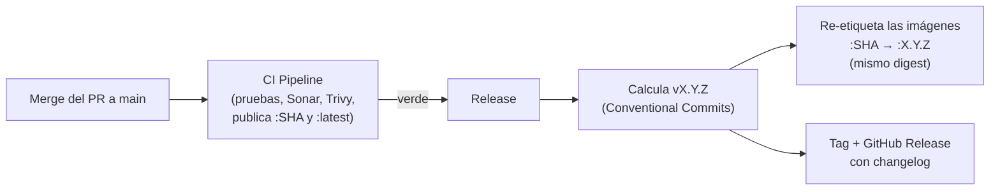

# Modificación 1: Versionado semántico automático y GitHub Releases

**Tipo:** pipeline · **Archivos:** `.github/workflows/release.yml`,
`.github/scripts/next-version.sh`, `.github/scripts/changelog.sh`

## Problema

El CI publica las imágenes con la etiqueta del SHA del commit (`a1b2c3…`) y con
`latest`. El SHA es perfecto para la trazabilidad, pero no le dice nada a una
persona: no se sabe si un cambio es una corrección o una funcionalidad nueva, ni
qué cambió entre una versión y otra. Crear tags `vX.Y.Z` a mano es fácil de
olvidar y se presta a errores.

## Solución

Un workflow nuevo, **Release**, que corre automáticamente cada vez que el
**CI Pipeline** termina en verde por un push a `main` (el merge de un PR):



1. **Calcula la versión** con [Conventional Commits](https://www.conventionalcommits.org/es/):

   | Mensaje de commit | Incremento | Ejemplo |
   |---|---|---|
   | `feat!: …` o `BREAKING CHANGE:` en el cuerpo | MAYOR | 1.4.2 → 2.0.0 |
   | `feat: …` / `feat(api): …` | MENOR | 1.4.2 → 1.5.0 |
   | `fix: …`, `docs: …`, `ci: …`, sin prefijo… | PARCHE | 1.4.2 → 1.4.3 |
   | Primer release del proyecto | — | v1.0.0 |

2. **Re-etiqueta las imágenes** que el CI ya probó y publicó: `passforge-backend:<sha>`
   pasa a tener también la etiqueta `passforge-backend:X.Y.Z`. Se usa
   `docker buildx imagetools create`, que crea la etiqueta nueva sobre el
   **mismo manifiesto**: no se reconstruye nada, así que la versión `X.Y.Z` es
   bit a bit la imagen que pasó todas las pruebas.
3. **Crea el tag y el GitHub Release** con el changelog agrupado por tipo
   (funcionalidades, correcciones, pipeline, pruebas, documentación…) y la lista
   de imágenes de esa versión.

## Cómo se integra con la estrategia de ramas

| Evento | CI Pipeline | Release |
|---|---|---|
| Pull Request hacia `main` | Valida, no publica | No corre |
| Merge a `main` | Publica `:SHA` y `:latest` | Crea `vX.Y.Z` y etiqueta las imágenes |
| Manual (`workflow_dispatch`) | — | Versiona el último commit de `main` |

El tag lo crea `GITHUB_TOKEN`, y GitHub no encadena workflows con ese token: el
tag **no** vuelve a disparar el CI. Por eso el Release re-etiqueta las imágenes
en vez de esperar una segunda construcción (más rápido y sin duplicar trabajo).

## Beneficios

- Versiones legibles (`v1.3.0`) que indican el tipo de cambio.
- Changelog automático en cada release, sin trabajo manual.
- Rollback más claro: se puede volver a `passforge-backend:1.2.0` en vez de a un SHA.
- La versión publicada es exactamente la imagen probada (mismo digest).

## Cómo escribir los commits (o los títulos de los PR)

```text
feat: agregar opción de excluir caracteres ambiguos
fix(api): validar longitud máxima de la contraseña
docs: documentar el pipeline de CD
ci: agregar pruebas de rendimiento con k6
```

## Evidencia para la presentación

- Pestaña **Actions → Release**: ejecución en verde después del CI.
- Pestaña **Releases** del repositorio: `PassForge vX.Y.Z` con su changelog.
- Docker Hub: las imágenes con las etiquetas `X.Y.Z`, `<sha>` y `latest`
  apuntando al mismo digest.
