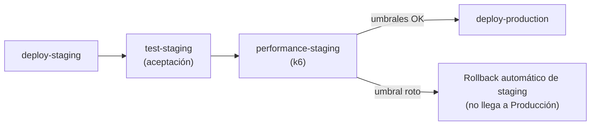

# Modificación 2: Pruebas de rendimiento con k6 antes de Producción

**Tipo:** pipeline · **Archivos:** `.github/workflows/performance.yml`,
`performance/load-test.js`

## Problema

Las pruebas de aceptación (Selenium) y de humo confirman que la aplicación
**funciona**, pero no que **aguante carga**. Una versión podría pasar todas las
pruebas funcionales y aun así ser lenta, fallar con varios usuarios a la vez o
haber perdido la protección contra abuso (rate limit), y llegaría a Producción
sin que nadie lo note.

## Solución

Una etapa nueva de **pruebas de rendimiento con [k6](https://k6.io)** contra
Staging, que funciona como **compuerta de calidad** antes de Producción:



`performance.yml` es un **workflow reutilizable** (`workflow_call`): el job
`performance-staging` de `cd.yml` lo llama con la URL del ALB de Staging y el
SHA del commit desplegado. `deploy-production` depende de él, y si falla se
activa `rollback-staging`. También se puede lanzar a mano desde
**Actions → Performance Tests**.

### Escenarios (perfil `gate`, ~2 minutos)

| Escenario | Qué hace | Qué valida |
|---|---|---|
| `carga` | Sube a 20 usuarios virtuales concurrentes sobre `/api/v1/health` | Latencia y errores del ALB + backend bajo concurrencia |
| `funcional` | Genera y evalúa contraseñas (20 por minuto, por debajo del rate limit) | Respuestas correctas (longitud, fortaleza, label) y latencia |
| `rate_limit` | Ráfaga de 200 peticiones a `/passwords/generate` | Que la protección contra abuso responda **429** |

### Umbrales (si uno se rompe, k6 sale con error y el pipeline falla)

| Métrica | Umbral |
|---|---|
| Latencia p95 en `carga` | < 500 ms |
| Latencia p95 en `funcional` | < 800 ms |
| Errores en `carga` y `funcional` | < 1 % |
| Validaciones funcionales (`checks`) | > 99 % |
| Respuestas 429 en la ráfaga | al menos 1 |

### Perfil `stress` (demostración del autoescalado)

Carga sostenida de 6 minutos que sube hasta 100 usuarios virtuales. Se lanza a
mano para mostrar cómo ECS agrega tareas del backend (modificación 3).

## Resultado local (backend en Docker)

```text
checks_succeeded...: 100.00% 10978 out of 10978
rate_limited_responses: 40
http_req_duration{escenario:carga}.....: p(95)=1.35ms
http_req_duration{escenario:funcional}.: p(95)=2.23ms
http_req_failed: 0.00% 0 out of 5577
```

## Hallazgo: el rate limit se multiplica por worker y por tarea

La app usa `RATELIMIT_STORAGE_URI=memory://`: cada **worker de Gunicorn** (2 por
contenedor) guarda su propio contador. En la prueba local, de 100 peticiones
seguidas pasaron 60 (2 workers × 30/min) y 40 recibieron 429. En AWS, con
varias tareas de ECS, el límite real es `30 × workers × tareas`: con el
autoescalado (hasta 3 tareas) llega a 180, por eso la ráfaga es de 200 (una de
100 no recibiría ningún 429 con 2 o más tareas y la compuerta fallaría sin que
la app tuviera un problema). La solución en
producción sería un almacenamiento compartido (Redis / ElastiCache), como ya
anticipa `backend/.env.example`. k6 lo deja medido y visible.

## Cómo ejecutarlo en local

```bash
docker compose up -d --build
docker run --rm --network passforge_default -v "$PWD/performance:/scripts:ro" \
  -e BASE_URL=http://backend:8000 grafana/k6:2.3.0 run /scripts/load-test.js
```

## Evidencia para la presentación

- Ejecución del CD con el job `performance-staging` en verde y el resumen de k6
  en la página de la ejecución (Step Summary).
- Artefacto `performance-reports-gate` con `k6-summary.json`.
