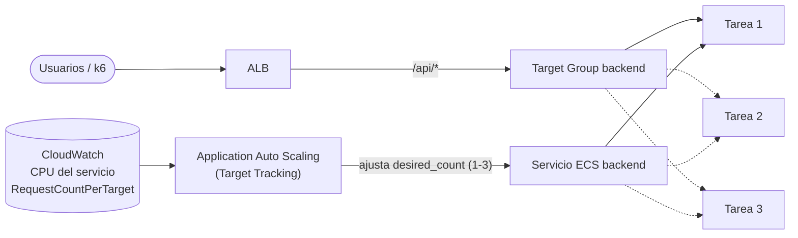

# Modificación 3: Autoescalado del backend en ECS

**Tipo:** arquitectura · **Archivos:** `infra/app/autoscaling.tf`,
`infra/app/variables.tf`, `infra/app/outputs.tf`

## Problema

El servicio del backend corría siempre con **una sola tarea** de Fargate
(0,25 vCPU, 512 MB). Si llega más tráfico del que esa tarea soporta, la
latencia sube y aparecen errores; si la tarea se cae, el servicio queda sin
capacidad mientras ECS la reemplaza. La capacidad era fija aunque la carga no lo
sea.

## Solución

**Autoescalado horizontal** con *Application Auto Scaling* y políticas
*Target Tracking*: ECS ajusta la cantidad de tareas del backend entre un mínimo
y un máximo para mantener dos métricas cerca de su objetivo.

| Política | Métrica | Objetivo | Por qué |
|---|---|---|---|
| CPU | `ECSServiceAverageCPUUtilization` | 60 % | Generar contraseñas y calcular su entropía consume CPU |
| Tráfico | `ALBRequestCountPerTarget` | 3000 peticiones por tarea por minuto | Reacciona al volumen aunque la CPU aún no suba |

- **Rango:** de 1 a 3 tareas (variables `backend_min_tasks` y
  `backend_max_tasks`). El máximo está limitado a 5 para cuidar el presupuesto
  del Learner Lab.
- **Escala hacia arriba** en 60 s y **hacia abajo** en 180 s para no oscilar.
- El servicio ya tenía `lifecycle { ignore_changes = [desired_count] }`, así que
  Terraform no deshace lo que decida el autoescalado en cada despliegue.
- Se puede apagar con `enable_autoscaling = false` sin tocar el resto.

## Cómo se relaciona con el resto del pipeline

- Las tareas nuevas usan la **misma Task Definition** (la misma imagen `:SHA`),
  y el ALB solo les envía tráfico cuando pasan el health check `/api/v1/health`.
- El **circuit breaker** y el **rollback** del CD siguen funcionando igual:
  afectan a todas las tareas del servicio.
- Las **pruebas de rendimiento (modificación 2)** con el perfil `stress` generan
  la carga para demostrarlo.

## Demostración en la presentación

1. Abrir **ECS → Clusters → passforge-staging-cluster → backend → Tasks**:
   1 tarea en ejecución.
2. Lanzar **Actions → Performance Tests → Run workflow** con la URL de Staging y
   el perfil `stress` (sube hasta 100 usuarios virtuales durante 6 minutos).
3. En 2 o 3 minutos, ver en la pestaña **Events** del servicio el mensaje
   `has started 1 tasks` y en **Tasks** las tareas nuevas; en
   **EC2 → Target Groups → passforge-staging-be-tg** aparecen más targets
   `healthy`.
4. En **CloudWatch → Alarms** se ven las alarmas `TargetTracking-…` que crea
   Application Auto Scaling (AlarmHigh / AlarmLow).
5. Al terminar la carga, unos minutos después el servicio vuelve a 1 tarea.

## Validación

- `terraform fmt -check` y `terraform validate` sin errores.
- Pendiente de comprobar en AWS: que el Learner Lab permita crear el
  *scalable target*. Si `terraform apply` falla con un error de permisos de
  Application Auto Scaling, se puede desplegar con
  `TF_VAR_enable_autoscaling=false` mientras se revisa, sin afectar al resto de
  la infraestructura.
